# Hey, I'm KJ — Kongphop Jamreansuk

**AI engineer for LLM systems, agents, and inference infrastructure.** 
Co-founder & CTO at Axtra Intellion · Bangkok, Thailand · [kjsc.dev](https://www.kjsc.dev) · [LinkedIn](https://www.linkedin.com/in/kongphop-jamreansuk/)

I take AI from a first proof of concept to a system that runs reliably in
production: serving open models on GPUs, building agent workflows whose
decisions can be audited, and making the tools that keep coding agents on track.
My rule is simple: *make it exist first, make it production-ready next.*

<picture>
  <source media="(prefers-reduced-motion: reduce)" srcset="./assets/kj-wordmark.svg" />
  
</picture>

[View still artwork](./assets/kj-wordmark.svg)

## Production work

- **LLM serving.** Deployed open models (Typhoon, Qwen, Gemma, GPT-OSS) behind
  OpenAI-compatible APIs with vLLM, then evaluated, tuned, and quantized them to
  fit on-premise and cloud GPU budgets.
- **Thai speech-to-text with PII masking.** On-premise call transcription for a
  PCI-DSS environment. Two NVIDIA L4 GPUs are shared between speech and LLM
  workloads, recordings are split at pauses, and an LLM picks the best of three
  Thai speech models for each call.
- **Auditable PII detection.** A LangGraph workflow that checks transcripts in
  overlapping chunks, re-verifies every finding to cut false positives, and keeps
  an audit trail so QA can review each masking decision.
- **Document and compliance AI.** An on-premise PDF and OCR extraction service
  that replaced a paid cloud API, and an LLM engine, still pre-launch, that checks
  pay against Australian Modern Award rules.
- **Agent-assist copilot.** Follows live support chats, finds the answer with RAG,
  and suggests a reply to the agent, reaching 95%+ tag recall.

Employers and dates are on my [CV](https://www.kjsc.dev/resume).

## Building Axtra Intellion

As co-founder and CTO, I'm building AXTL. You describe the backend you need in
plain English and review the spec it writes. AXTL then generates the code, tests
it in a sandbox, and deploys a FastAPI agent backend. It runs on Cloud Run, Cloud
Build, and Cloudflare Workers, and is in pre-launch testing.

## Open source

**[Heli-Harness](https://github.com/KJ-AIML/heli-harness)** · Agent development workflow 
Carry project context, policies, and task handoffs between coding tools and
repositories. Built for work that continues across agent sessions. 
[Get started](https://github.com/KJ-AIML/heli-harness#install-v0120) · [npm](https://www.npmjs.com/package/heli-harness) · [Releases](https://github.com/KJ-AIML/heli-harness/releases)

**[MemCtrl](https://github.com/KJ-AIML/memctrl)** · Rust + SQLite 
Local memory for coding agents, with full-text retrieval and source hashes that
flag stale context. Inspect what an agent remembers and where it came from. 
[Get started](https://github.com/KJ-AIML/memctrl#quick-start) · [Releases](https://github.com/KJ-AIML/memctrl/releases)

**[ALMS](https://github.com/KJ-AIML/alms)** · Python + FastAPI 
A backend starter and CLI with explicit application and agent layers. Scaffold
the database, observability, and container setup your project needs. 
[Get started](https://github.com/KJ-AIML/alms#quick-start-with-cli) · [Releases](https://github.com/KJ-AIML/alms/releases)

**[Samo](https://github.com/KJ-AIML/samo)** · Rust + GPUI 
A native disk and system monitor for finding large files, inspecting resource
usage, and cleaning up development build artifacts. 
[Source](https://github.com/KJ-AIML/samo) · [Downloads](https://github.com/KJ-AIML/samo/releases)

I contributed a [fullscreen fix to OpenIDEA](https://github.com/l0ng-ai/openidea/pull/1608)
for grouped project windows on notched Macs. It was merged and shipped in
[v0.1.38](https://github.com/l0ng-ai/openidea/releases/tag/v0.1.38).

I also build [AXGA](https://github.com/KJ-AIML/axga-harness-agent-rs), a small
Rust coding agent made to run on a cheap VPS, and [Clarify](https://github.com/KJ-AIML/clarify),
which turns Markdown into interactive architecture and decision boards. I also
maintain an [agent backend field guide](https://github.com/KJ-AIML/agent-native-backend).

## Stack

**LLM & agents:** LangGraph, LangChain, RAG, multi-agent workflows, open-source LLMs 
**Inference & GPU:** vLLM, Ollama, quantization, model evaluation, GPU-aware scheduling 
**Speech & documents:** Thai ASR (Typhoon, Pathumma), voice activity detection, PII masking, OCR 
**Backend & infra:** Python, FastAPI, Rust (Axum, SQLx), TypeScript/React, PostgreSQL, pgvector, Redis, Docker, GitHub Actions, GCP, Cloudflare Workers

## Working with me

I'm open to AI platform and AI engineering opportunities, and to collaboration
from anywhere. Reach me through [kjsc.dev](https://www.kjsc.dev) or
[LinkedIn](https://www.linkedin.com/in/kongphop-jamreansuk/).

Original ASCII artwork, generated locally. [Design](./docs/design-system.md) · [Sources](./docs/profile-refresh/sources.md)
