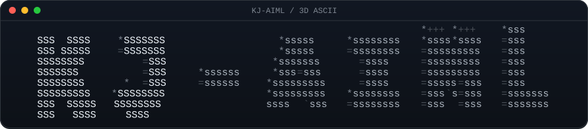

# Hey, I'm KJ — Kongphop Jamreansuk

**AI engineer building agent infrastructure, backend systems, and developer tools.** 
Bangkok, Thailand · [LinkedIn](https://www.linkedin.com/in/kongphop-jamreansuk/)

I build tools for the work around an AI agent: keeping context useful, making
decisions traceable, and turning a prototype into a maintainable application.
Most of my work is in Python, Rust, and TypeScript.

## Selected work

**[Heli-Harness](https://github.com/KJ-AIML/heli-harness)** · Agent development workflow 
Carry project context, policies, and task handoffs between coding tools and
repositories. Built for work that continues across agent sessions. 
[Get started](https://github.com/KJ-AIML/heli-harness#install-v0120) · [Releases](https://github.com/KJ-AIML/heli-harness/releases)

**[MemCtrl](https://github.com/KJ-AIML/memctrl)** · Rust + SQLite 
Local memory for coding agents, with full-text retrieval and source hashes that
flag stale context. Inspect what an agent remembers and where it came from. 
[Get started](https://github.com/KJ-AIML/memctrl#quick-start) · [Releases](https://github.com/KJ-AIML/memctrl/releases)

**[ALMS](https://github.com/KJ-AIML/alms)** · Python + FastAPI 
A backend starter and CLI with explicit application and agent layers. Scaffold
the database, observability, and container setup your project needs. 
[Get started](https://github.com/KJ-AIML/alms#quick-start-with-cli) · [Releases](https://github.com/KJ-AIML/alms/releases)

**[Samo](https://github.com/KJ-AIML/samo)** · Rust + GPUI 
A native disk and system monitor for finding large files, inspecting resource
usage, and cleaning up development build artifacts. 
[Source](https://github.com/KJ-AIML/samo) · [Downloads](https://github.com/KJ-AIML/samo/releases)

## Beyond my own repos

I contributed a [fullscreen fix to OpenIDEA](https://github.com/l0ng-ai/openidea/pull/1608)
for grouped project windows on notched Macs. The fix was merged and shipped in
[v0.1.38](https://github.com/l0ng-ai/openidea/releases/tag/v0.1.38).

I also build [Clarify](https://github.com/KJ-AIML/clarify), which turns Markdown
into interactive architecture and decision boards, and maintain an
[agent backend field guide](https://github.com/KJ-AIML/agent-native-backend).

## Working with me

**Languages:** Python, Rust, TypeScript 
**Backend & agents:** FastAPI, LangGraph, LangChain 
**Infrastructure:** Docker, Google Cloud

Working on agent infrastructure or a useful developer tool?
[Let's connect on LinkedIn](https://www.linkedin.com/in/kongphop-jamreansuk/).

Original ASCII artwork, generated locally. [Design](./docs/design-system.md) · [Sources](./docs/profile-refresh/sources.md)
