<picture>
  <source media="(prefers-reduced-motion: reduce)" srcset="./assets/kj-hello-still.svg" />
  
</picture>

[View still artwork](./assets/kj-hello-still.svg)

# Hey, I'm KJ — Kongphop Jamreansuk

**AI engineer for LLM systems, agents, and inference infrastructure.** 
Co-founder & CTO at [Talvyn Labs](https://talvynlabs.com) and Axtra Intellion · Bangkok, Thailand

<a href="https://www.kjsc.dev">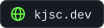</a>

<a href="https://www.kjsc.dev/resume">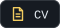</a>
<a href="https://www.npmjs.com/package/heli-harness">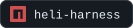</a>

I take AI from a first proof of concept to a system that runs reliably in
production: serving open models on GPUs, building agent workflows whose
decisions can be audited, and making the tools that keep coding agents on track.
My rule is simple: *make it exist first, make it production-ready next.*

## Production work

- **LLM serving.** Deployed open models (Typhoon, Qwen, Gemma, GPT-OSS) behind
  OpenAI-compatible APIs with vLLM, then evaluated, tuned, and quantized them to
  fit on-premise and cloud GPU budgets.
- **Thai speech-to-text with PII masking.** On-premise call transcription for a
  PCI-DSS environment. Two NVIDIA L4 GPUs are shared between speech and LLM
  workloads, recordings are split at pauses, and an LLM picks the best of three
  Thai speech models for each call.
- **Auditable PII detection.** A LangGraph workflow that checks transcripts in
  overlapping chunks, re-verifies every finding to cut false positives, and keeps
  an audit trail so QA can review each masking decision.
- **Document and compliance AI.** An on-premise PDF and OCR extraction service
  that replaced a paid cloud API, and an LLM engine, still pre-launch, that checks
  pay against Australian Modern Award rules.
- **Agent-assist copilot.** Follows live support chats, finds the answer with RAG,
  and suggests a reply to the agent, reaching 95%+ tag recall.

Employers and dates are on my [CV](https://www.kjsc.dev/resume).

## Companies

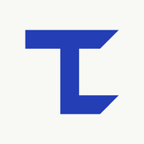 **[Talvyn Labs](https://talvynlabs.com)** · Co-founder & CTO 
A software house and product studio in Bangkok. We design and build AI agents,
automation, websites, and web apps for businesses, and keep them running after
launch. Our products include TalvynCRM, a CRM shaped around how each business
works, and TalvynMesher, a workspace where AI agents share context and people
approve what goes out.

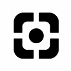 **Axtra Intellion (AXTL)** · Co-founder & CTO 
I'm building AXTL. You describe the backend you need in plain English and review
the spec it writes. AXTL then generates the code, tests it in a sandbox, and
deploys a FastAPI agent backend. It runs on Cloud Run, Cloud Build, and
Cloudflare Workers, and is in pre-launch testing.

## Open source

<table>
<tr>
<td width="50%" valign="top">
<a href="https://github.com/KJ-AIML/heli-harness">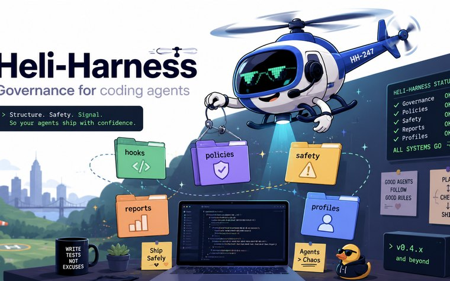</a> 
<b><a href="https://github.com/KJ-AIML/heli-harness">Heli-Harness</a></b> ·  npm package 
Carries project context, policies, and task handoffs between coding tools and repositories. 
<a href="https://github.com/KJ-AIML/heli-harness#readme">Get started</a> · <a href="https://www.npmjs.com/package/heli-harness">npm</a> · <a href="https://github.com/KJ-AIML/heli-harness/releases">Releases</a>
</td>
<td width="50%" valign="top">
<a href="https://github.com/KJ-AIML/samo">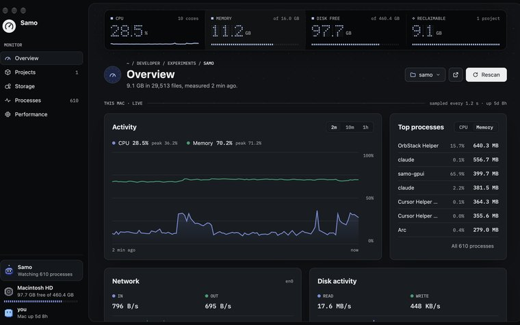</a> 
<b><a href="https://github.com/KJ-AIML/samo">Samo</a></b> ·  Rust + GPUI 
A native Mac disk and system monitor that finds large files and cleans up build artifacts. 
<a href="https://github.com/KJ-AIML/samo">Source</a> · <a href="https://github.com/KJ-AIML/samo/releases">Downloads</a>
</td>
</tr>
<tr>
<td width="50%" valign="top">
<a href="https://github.com/KJ-AIML/memctrl">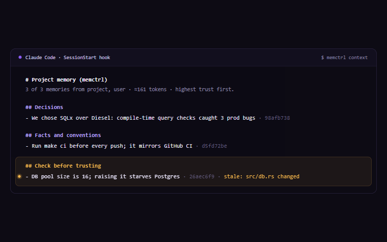</a> 
<b><a href="https://github.com/KJ-AIML/memctrl">MemCtrl</a></b> ·   Rust + SQLite 
Local memory for coding agents that flags stale context and shows where each memory came from. 
<a href="https://github.com/KJ-AIML/memctrl#quick-start">Get started</a> · <a href="https://github.com/KJ-AIML/memctrl/releases">Releases</a>
</td>
<td width="50%" valign="top">
<a href="https://github.com/KJ-AIML/clarify">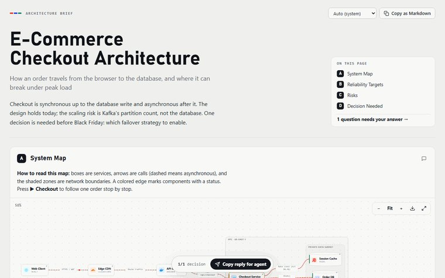</a> 
<b><a href="https://github.com/KJ-AIML/clarify">Clarify</a></b> ·  JavaScript 
Turns Markdown into interactive architecture and decision boards for you and your coding agent. 
<a href="https://github.com/KJ-AIML/clarify">Source</a>
</td>
</tr>
<tr>
<td width="50%" valign="top">
<a href="https://github.com/KJ-AIML/alms">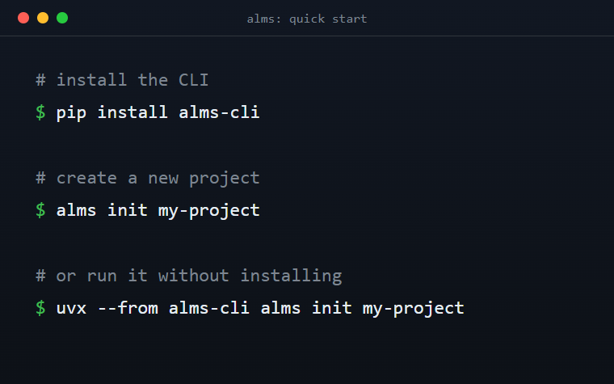</a> 
<b><a href="https://github.com/KJ-AIML/alms">ALMS</a></b> ·   Python + FastAPI 
A backend starter and CLI with explicit application and agent layers. 
<a href="https://github.com/KJ-AIML/alms#quick-start-with-cli">Get started</a> · <a href="https://github.com/KJ-AIML/alms/releases">Releases</a>
</td>
<td width="50%" valign="top">
<a href="https://github.com/KJ-AIML/axga-harness-agent-rs">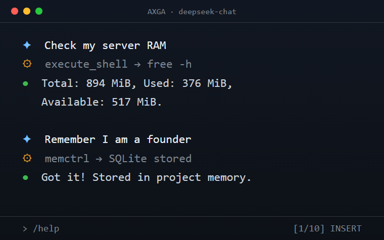</a> 
<b><a href="https://github.com/KJ-AIML/axga-harness-agent-rs">AXGA</a></b> ·  Rust 
A small coding agent made to run on a cheap VPS. 
<a href="https://github.com/KJ-AIML/axga-harness-agent-rs">Source</a> · <a href="https://github.com/KJ-AIML/axga-harness-agent-rs/releases">Releases</a>
</td>
</tr>
</table>

I contributed a [fullscreen fix to OpenIDEA](https://github.com/l0ng-ai/openidea/pull/1608)
for grouped project windows on notched Macs. It was merged and shipped in
[v0.1.38](https://github.com/l0ng-ai/openidea/releases/tag/v0.1.38). I also
maintain an [agent backend field guide](https://github.com/KJ-AIML/agent-native-backend).

## Stack

Full stack

 

**LLM & agents:** LangGraph, LangChain, RAG, multi-agent workflows, open-source LLMs 
**Inference & GPU:** vLLM, Ollama, quantization, model evaluation, GPU-aware scheduling 
**Speech & documents:** Thai ASR (Typhoon, Pathumma), voice activity detection, PII masking, OCR 
**Backend & infra:** Python, FastAPI, PyTorch, Rust (Axum, SQLx), TypeScript/React, PostgreSQL, pgvector, Redis, Docker, GitHub Actions, GCP, Cloudflare Workers

## Working with me

I'm open to AI platform and AI engineering opportunities, and to collaboration
from anywhere. Reach me through [kjsc.dev](https://www.kjsc.dev) or
[LinkedIn](https://www.linkedin.com/in/kongphop-jamreansuk/).

The hand artwork is adapted from my [pi-ter](https://github.com/KJ-AIML/pi-ter) project, and every image here is a local file. [Design](./docs/design-system.md) · [Sources](./docs/profile-refresh/sources.md)
