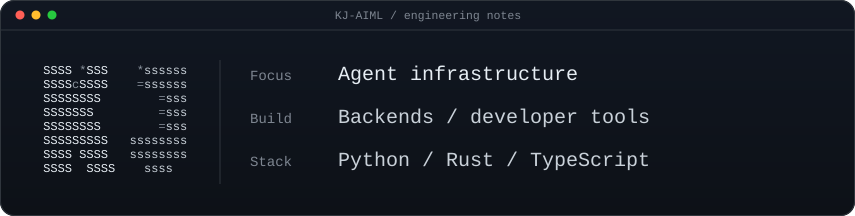

# KJ-AIML profile design

The profile pairs a terminal/ASCII identity with ordinary Markdown. A visitor can
read the name, focus, projects, contribution evidence, and contact link immediately,
including when images are unavailable.

## Reading order

1. Name, engineering focus, location, and LinkedIn.
2. A compact, static 3D ASCII wordmark.
3. Four current projects, each explaining its purpose and linking to usable code.
4. A merged contribution outside this account, linked to its PR and release.
5. Working stack and an invitation to connect.

Project descriptions use single-column paragraphs so they wrap naturally on a
phone. Technologies support the work examples. Public claims and their verification
sources live in [the source notes](profile-refresh/sources.md).

## Artwork

The main profile uses only [the wordmark](../assets/kj-wordmark.svg). Its 855px-wide
canvas has compact framing and a visible rest pose. There is no boot delay, motion,
or hidden reveal state in the committed asset.

The optional panel below preserves the CLI visual language for reuse. It is a
static illustration. It carries no information that is necessary to understand
the profile.

Both SVGs include a title and description. They contain no animation elements,
scripts, remote resources, or simulated keyboard controls. The profile therefore
does not need a motion preference to produce its readable state.

## Palette and typography

| Token | Value | Use |
| --- | --- | --- |
| Background | `#0d1117` | Canvas |
| Panel top | `#111722` | Terminal gradient |
| Border | `#30363d` | Frame and rules |
| Signal | `#e6edf3` | Primary emphasis |
| Text | `#c9d1d9` | Body copy |
| Dim | `#8b949e` | Secondary copy |
| Muted | `#7d8590` | Chrome and captions |

The wordmark uses glyph density and neutral shades to distinguish letter faces
from extruded walls. Its geometry is generated from the bundled IBM Plex Mono
Bold font, with the font's license and source recorded in
[assets/fonts](../assets/fonts/). It does not depend on an installed operating
system font. SVG text uses a local monospace fallback stack and fixed text lengths;
no font is downloaded when a visitor opens the profile.

See [the renderer notes](3d-ascii-wordmark.md) and
[maintenance instructions](maintenance.md) for reproducible generation and checks.
